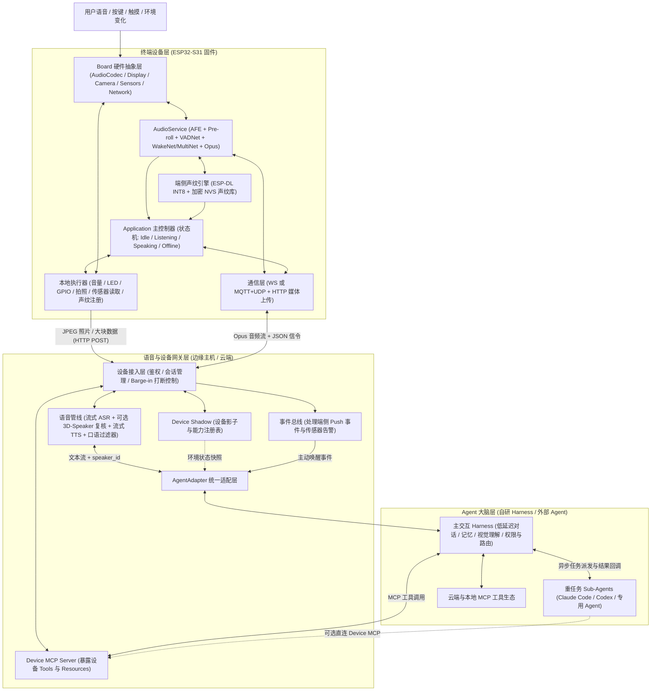
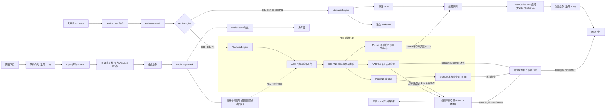
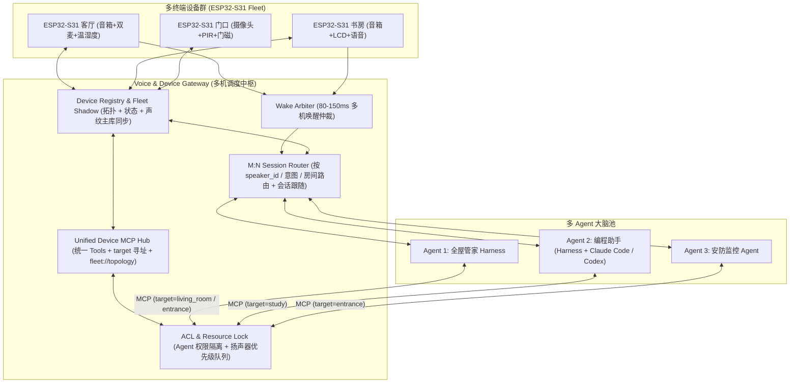
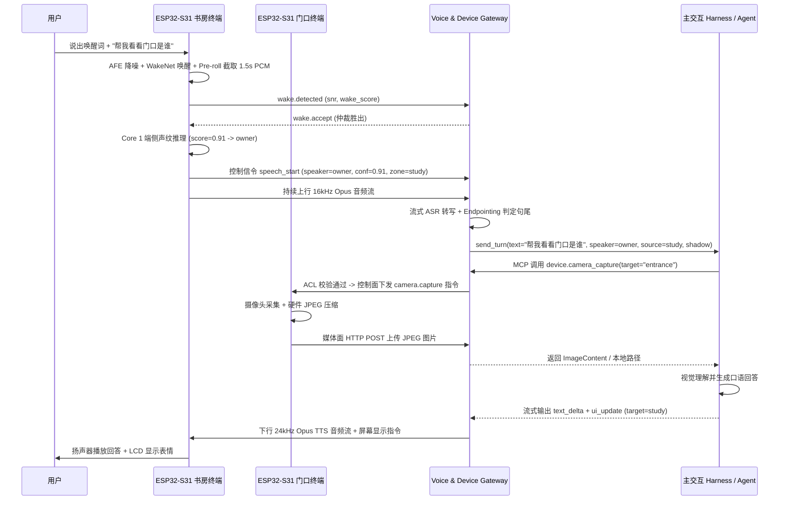

# ESP32-S31 智能语音与多模态 Agent 终端系统架构设计文档

> **版本**：v1.6  
> **目标硬件**：ESP32-S31（兼容 ESP32-S3 / P4 高性能平台，支持 C3 / C5 / C6 / ESP32 轻量降级）  
> **开发框架**：ESP-IDF v6.x（终端）+ EZ Assistant `Device Protocol 1.0` 原生直连与原生控制面板/MCP/声纹/多模唤醒（默认消费级模式） / Go Kratos v2 + NATS JetStream（集群网关模式）

---

## 1. 设计背景与核心思想

本架构面向具备**语音交互、端侧身份识别、摄像头与多传感器感知、以及现代 AI Agent 协同能力**的嵌入式 AIoT 终端。整体设计在借鉴 `xiaozhi-esp32` 端云解耦思想的基础上，进一步将 **VAD 与端侧声纹识别**下沉至硬件端，并引入基于 **Go Kratos（原生 gRPC + HTTP）+ NATS JetStream 事件总线** 的 **Voice & Device Gateway（语音与设备网关）** 与 **MCP（Model Context Protocol）** 标准协议，使硬件外设无缝转化为任意 Agent（自研 Agent、Claude Code、Codex 等）的原生能力，并原生支持 **1:N 与 M:N 多终端 × 多 Agent 拓扑扩展**、**局域网零配置服务发现（mDNS）**与**出厂 MAC 地址唯一认证**。

### 核心架构原则

1. **端侧重实时与门控**：设备端负责 I2S 音频采集/播放、AFE 音频前处理、离线唤醒、本地 VAD、**端侧声纹鉴权**、Opus 编解码、UI 显示及本地外设执行。
2. **网关重桥接与解耦**：服务端作为语音与设备网关（可部署于公网云端或局域网边缘主机），终结设备连接、处理语音流（ASR/TTS/云端复核声纹）、维护设备影子，并将硬件能力统一封装为标准 **MCP Server**。
3. **大脑重编排与分级**：Agent 层与硬件完全解耦，采用**“低延迟主交互 Harness + 异步重任务 Sub-Agent（Claude Code / Codex）”**双层架构，兼顾语音实时体验与复杂工程执行能力。
4. **控制面、音频面、媒体面分离**：信令控制、实时低延迟音频、摄像头大块图片/传感数据走不同传输通道，互不阻塞。
5. **实体解耦支持 M:N 扩展**：彻底解耦物理设备（`Device`）、对话会话（`Session`）与智能体（`Agent`），支持单 Agent 跨多终端协同与多 Agent 共享设备池。

---

## 2. 硬件平台与 ESP-IDF 技术选型

### 2.1 ESP32-S31 核心硬件能力

| 维度 | ESP32-S31 特性 | 对本架构的价值 |
| :--- | :--- | :--- |
| **主处理器** | 300 MHz 高性能 32 位 **RISC-V 双核**（PRO CPU + APP CPU） | 支持 FreeRTOS SMP 双核隔离：Core 0 跑强实时音频，Core 1 跑端侧 AI 推理与网络 |
| **超低功耗协处理器** | **ULP LP Core**（RISC-V RV32IMAC，支持中断/JTAG/PMP） | 电池供电休眠时可做极低功耗声音能量/传感器初筛，触发后唤醒主核 |
| **网络连接** | 2.4 GHz **Wi-Fi 6**、Bluetooth 5.4 (LE + Classic)、IEEE 802.15.4 (Thread/Zigbee)、以太网 MAC | Wi-Fi 6 降低弱网空口抖动；支持 BLE 安全配网与本地近场控制 |
| **多媒体与外设** | 硬件 **JPEG 编解码器**、**LCD**、**PPA（像素处理加速器）**、USB 2.0 HS OTG、I2S/I2C/SPI/UART/ADC/TWAI | 卸载拍照 JPEG 压缩与 LCD 表情渲染的 CPU 开销 |
| **调试与烧录** | 内置 **USB 串口/JTAG 控制器**（GPIO34 D+ / GPIO33 D-） | 单根 USB 线同时支持串口监视与 OpenOCD JTAG 调试 |
| **硬件安全** | Secure Boot v2（RSA-3072）、XTS-AES Flash/PSRAM 加密、NVS 加密、ECDSA_DS/RSA_DS、Recovery Bootloader | 保护本地声纹模板、设备凭据与固件防篡改/防回滚 |
| **官方参考开发板** | `ESP32-S31-Function-CoreBoard-1`、`ESP32-S31-Korvo-1`（双麦阵列+扬声器+DVP 摄像头+4.3 寸 LCD） | 与本架构的音频/视觉/HMI 需求天然对齐 |

### 2.2 芯片分级音频引擎策略

* **`AfeAudioEngine`（ESP32-S31 / ESP32-S3 / ESP32-P4）**：启用完整 ESP-SR AFE 流水线（AEC + BSS/NS + VADNet + WakeNet/MultiNet）与端侧声纹推理。
* **`LiteAudioEngine`（ESP32-C3 / C5 / C6 / ESP32）**：关闭重前端，采用独立轻量 WakeNet + 原始 PCM 上行，声纹与高级降噪交由网关侧完成。

### 2.3 开发工作流约定（ESP-IDF v6.x）

* 使用 **EIM（ESP-IDF Installation Manager）** 管理工具链与 SDK 版本（Python >= 3.11，macOS/Linux/Windows 统一）。
* 项目基于 CMake + Ninja + 组件化构建（`main/` + `components/` + `managed_components/`），通过 `idf.py set-target esp32s31`、`idf.py menuconfig`、`idf.py build`、`idf.py flash monitor` 闭环开发。
* 外设代码严格遵循 ESP-IDF 硬件抽象分层（优先调用 `driver/` 公共 API，避免业务层直接耦合 `hal/` / `soc/` 私有寄存器接口）。

---

## 3. 端-网-脑三层整体架构



---

## 4. 终端设备端详细设计（ESP32-S31 固件）

### 4.1 音频与端侧 AI 流水线



#### 音频流水线关键工程约束

1. **AEC 参考信号与采样率对齐**：
   * 开启全双工 AEC（Realtime 模式或播报打断）时，必须向 AEC 提供与麦克风同源对齐的扬声器参考信号（通过 Codec 硬件回采通道或播放路径软回环）。
   * 上行为 16 kHz Opus，下行通常为 24 kHz Opus；若启用 AEC 或共用 I2S 时钟，需在播放侧做重采样（24 kHz → 16 kHz）或采用独立 I2S 控制器。
2. **Opus 帧长权衡**：
   * 常规对话推荐 **60 ms** 帧长以降低发包频率与协议开销；追求极低延迟的全双工 Realtime 场景建议支持配置切换为 **20 ms / 40 ms**。
3. **有界队列背压**：
   * 上行 `SendQ ≤ 2.4s`、下行 `DecodeQ ≤ 1.2s`，超限时按策略丢弃旧帧，防止弱网 OOM 与延迟累积。

### 4.2 端侧 VAD 方案

* **核心引擎**：优先采用 ESP-SR 内置 **VADNet**，与 AEC/NS 共享帧处理，低延迟且对稳态噪声鲁棒。
* **Pre-roll 防吞字**：维护 300~500 ms PCM 环形缓冲；VAD 触发 `speaking` 时，将缓冲头部音频一并送入编码队列或声纹引擎，避免丢失首字。
* **职责边界**：端侧 VAD 负责本地 LED/表情反馈、静音过滤省流量、以及切分有效语音段给端侧声纹；**不直接强行截断云端对话轮次**，最终的语义端点检测（Endpointing）由网关/ASR 结合语意决定。
* **超低功耗模式（可选）**：电池场景下，主核进入 Light/Deep-sleep，由 ESP32-S31 的 **ULP LP Core** 执行轻量能量/过零率检测，超过阈值再唤醒 HP Core 运行 VADNet 与 WakeNet。

### 4.3 设备端 Wi-Fi 管理、自动联网与双模配网（ESP-Mosaico）

1. **多网络加密 NVS 持久化（`wifi_store`）**：
   * 在 NVS 命名空间 `wifi_store` 中保存最多 **8 组** Wi-Fi 凭据（按 `last_used_seq` LRU 排序）及可选网关直连覆盖地址（`gateway_override: host:port`），通过二进制魔数 + FNV-1a 校验持久化；启用量产加密时随 NVS 加密一并受硬件密钥保护。
   * 当 NVS 凭据库为空且编译期配置了 `CONFIG_ESP_PIKA_WIFI_SSID` 时，首次启动自动写入一条种子记录（不覆盖用户后续新增或遗忘操作）。
2. **自动联网、故障转移与断线重连**：
   * 上电后由运行在 Core 1 片内 DRAM 栈的独立 `NetWorkerTask`（不阻塞 Core 0 音频与 `UiRenderTask` / `app_main` 20ms 主循环）异步执行：优先连接最近一次成功的 Wi-Fi；若失败则主动扫描 2.4 GHz 信道，按信号强度（RSSI）降序依次尝试当前可见的已保存网络。
   * 运行时若意外掉线，先按退避间隔（2s / 4s / 6s）重试当前网络（最多 3 次），随后自动扫描并故障转移至其他已保存网络；若仍无可用网络，则自动拉起 SoftAP Captive Portal 等待配网（当自动进入配网模式且无手机/客户端连入 AP 时，每 45 秒周期性重扫并在已保存网络恢复后自动回连）。
3. **双模配网与本地网络切换**：
   * **端侧屏幕直连配网（ESP-Mosaico 480×480 触摸屏）**：点击顶部状态栏 Wi-Fi/链路图标或下拉控制抽屉的 `WIFI >` 按钮进入独立 Wi-Fi 管理页，支持扫描、切换已保存/开放/加密网络、遗忘凭据、开关本地配网热点，以及调用内置四层触摸软键盘（小写 QWERTY / 大写 / `123` / `SYM`）输入 Wi-Fi 密码。
   * **零 App SoftAP Captive Portal（`ESP-Mosaico-XXXX`）**：在 `WIFI_MODE_APSTA` 下开启开放热点（后缀取自 eFuse MAC 末 4 位大写十六进制），启动 Core 1 `DnsPortalTask`（UDP 53 通配解析至 `192.168.4.1`）与 `esp_http_server` 配网页面及 REST API（`/api/wifi/status`、`/api/wifi/scan`、`/api/wifi/connect`、`/api/wifi/forget`、`/api/wifi/gateway`、通配 302 跳转）。**安全边界**：Portal 仅在配网/热点模式开启，STA 连网成功并展示新 IP 后约 4 秒自动关闭 HTTP/DNS 与 SoftAP，切回纯 `WIFI_MODE_STA`，不在正常在线态常驻开放未认证 HTTP 端口。
4. **切网无缝恢复网关会话**：
   * Wi-Fi 连接建立、切换 SSID 或 IP 变更时，应用层断开旧 WebSocket 并触发 mDNS `_esp-gateway._tcp.local` 重发现（若无 mDNS 响应，优先采用用户在配网页/NVS 设置的网关覆盖地址，否则回退 Kconfig 默认网关），无需重启设备即可自动重建与网关的 `device.hello` 会话。

### 4.4 端侧声纹识别（On-Device Voiceprint）方案

| 环节 | 推荐实现方案 |
| :--- | :--- |
| **音频特征** | 基于 `esp-dsp` 对 16 kHz PCM 提取 40~80 维 **FBank / MFCC**（25 ms 窗长，10 ms 帧移） |
| **模型与推理** | INT8 量化轻量声纹网络（**ECAPA-TDNN Lite** / **Tiny-CAM++** / **DS-CNN**，体积 300 KB ~ 2 MB），输出 128~192 维 L2 归一化 Embedding；通过 **ESP-DL** 执行推理 |
| **触发模式 A（推荐）** | **文本相关（唤醒词声纹）**：唤醒瞬间截取 Pre-roll 中 1.0~1.5 s 唤醒词 PCM 推理 1 次（耗时约 50~150 ms），文本一致使端侧小模型误识率（EER）显著降低 |
| **触发模式 B（补充）** | **文本无关（持续说话人验证）**：由 VAD 截取 1.5~3 s 有效人声，投递至 Core 1 低优先级任务异步推理，不阻塞实时音频流 |
| **存储与比对** | 注册时录入 3~5 句样本取均值归一化，存入开启 **NVS 加密** 的本地分区（192 维 float32 仅 768 B/人）；推理时通过余弦相似度匹配 |
| **端云分级策略** | `score >= 0.85` 端侧直接采信；`0.65 <= score < 0.85` 标记 `uncertain` 交网关 3D-Speaker 复核；`score < 0.65` 在严格模式下本地拒绝或降权为 `guest` |

### 4.5 其他端侧感知扩展

* **离线命令词（MultiNet）**：结合端侧声纹，实现断网状态下“仅主人可触发的本地硬件控制”。
* **声源定位（DOA）**：配合双麦阵列（如 `ESP32-S31-Korvo-1`）输出方位角，用于机器人转向或空间上下文。
* **声音事件检测（SED）**：轻量分类模型监测哭声、敲门、报警声等异常事件，主动触发 Push 通知 Agent。

### 4.6 ESP32-S31 双核 SMP 调度与内存/分区规划

#### 双核任务分配建议
* **HP Core 0（实时音频域）**：`AudioInputTask`、`AfeAudioEngine`（AEC/NS/VAD/WakeNet）、`OpusCodecTask`、`AudioOutputTask`。
* **HP Core 1（推理与系统域）**：`VoiceprintTask`（低优先级异步推理）、`SedTask`、`Application` 状态机、`NetWorkerTask`（Wi-Fi 扫描/重连与 NVS 写入，片内 DRAM 栈）、`DnsPortalTask`（仅配网期间运行）、Wi-Fi/lwIP/WebSocket/MQTT 网络任务、UI 渲染与相机采集任务。

#### 内存分配约束
* **片内 DRAM（`MALLOC_CAP_DMA` / `INTERNAL`）**：I2S DMA 缓冲区、AFE 实时工作帧、中断回调数据（`IRAM_ATTR` / `DRAM_ATTR`）、FreeRTOS 任务 TCB 及需执行 Flash 写入的任务栈。
* **片外 PSRAM（`MALLOC_CAP_SPIRAM`）**：Pre-roll 缓冲、Opus 队列、声纹推理 Tensor Arena、摄像头帧缓冲、LCD 显存。
* **Flash 分区表规划示例**：

```csv
# Name,           Type, SubType, Offset,   Size,   Flags
nvs,              data, nvs,     ,         0x6000,
nvs_keys,         data, nvs_keys,,         0x1000, encrypted
otadata,          data, ota,     ,         0x2000,
phy_init,         data, phy,     ,         0x1000,
ota_0,            app,  ota_0,   ,         3M,
ota_1,            app,  ota_1,   ,         3M,
model,            data, spiffs,  ,         4M,     readonly
```

> 注：ESP32-S31 建议启用 ROM 级 **Recovery Bootloader** 与防回滚配置，进一步提高 OTA 升级安全性。

### 4.7 双模传输架构：EZ Assistant 原生直连（默认）与网关集群模式

为兼顾**消费级零配置即插即用**与**多终端企业/极客集群调度**，Mosaico 终端（ESP32-S31）在网络与音频传输层采用**双模自动切换架构**（以 `WifiStore::GatewayOverride().enabled` 作为模式开关）：

1. **EZ Assistant 原生直连模式（默认，`gateway_override.enabled == false`）**：
   * **零网关广播与发现**：未配对且连上 Wi-Fi 时，终端通过 `EzDeviceClient` 启动端口 `8765` 的轻量控制服务（`GET /ez/info`、`POST /ez/connect`）并通过 mDNS 广播 `_ez-device._tcp.local.`（TXT 携带 `v=1`、`mac`、`name`、`model`、`paired=0`、`pk_fp`、`fw`）。
   * **一键免码安全配对**：EZ Assistant 桌面端自动浏览 `_ez-device._tcp.local.` 并展示附近设备；用户点击「连接」后，桌面端自动启用接入开关、为该设备的 Ed25519 公钥指纹（`pk_fp`）与对端 IP 开启 60 秒定向自动审批窗口，并向终端 `POST http://<mosaico-ip>:8765/ez/connect` 下发 WSS 连接参数（同时以 `_ez-assistant._tcp.local.` mDNS 广播作为回退）。
   * **TLS 证书钉扎与 RFC 8032 Ed25519 长期身份**：终端使用叶证书 SHA-256 指纹钉扎建立 WSS `/device` 连接，完成 `direct_confirm` 挑战签名后将 `{installation_id, cert_fingerprint, device_id, ed25519_seed}` 写入加密 NVS 命名空间 `ez_pair`，随后自动停用 `_ez-device._tcp` 与 `8765` 端口监听，并凭 `hello` + 动态端口 mDNS（`_ez-assistant._tcp.local.`）实现无感断线重连。
   * **端到端 20ms PCM16 语音流与全双工打断（Barge-in）**：`AudioEngine` 切换为 `AudioTransportCodec::kPcm16_20ms`，直接发送 `listen_start` + 656 字节定长二进制帧（16 字节大端头部 + 640 字节 16 kHz 单声道 PCM16，`kind=1`），并接收 Host 下行 `playback_start` / `kind=2` PCM16 播放。播报长文本期间保持 ESP-SR AEC（`"MR"` 参考回路）与唤醒/声纹直唤持续工作（`voiceprint_direct` 在播报期间自动启用更高 SNR 与声纹阈值防自激），同时支持点击屏幕头像一键打断；任意端侧语音/触屏打断会立即在 `< 20 ms` 内淡出静音并上发 `playback_cancel` / `listen_start`，Host 侧同步清空该长回复剩余待播 TTS 队列并取消当前活动 Run；此外，用户在 EZ Assistant 桌面端向主控会话提交新内容或取消 Run 时，Host 也会自动向在线播放终端广播 `InterruptPlayback`（`playback_end(reason="interrupted_by_input")`）即时终止旧播报。
   * **Phase 2 原生直连控制面板、WSS 硬件指令、自动 MCP 与端云协同声纹（零外部网关）**：
     * **零新增端口的 WSS 硬件控制**：直连终端在已认证的 `hello.hardware` 中声明硬件档案（`mac`、`chip`、`model`、`zone`、`group_id`、`vp_version`、`capabilities`）；Host 与终端复用已钉扎证书的 WSS `/device` 通道收发 `device_command` / `device_command_result`（由终端 Core 1 片内 DRAM 栈上的 `LocalExecutor` 执行 `device.display_show`、`device.audio_set_volume`、`device.sensor_read`、`device.actuator_set`、`device.status_read`、`device.voiceprint_list`、`device.voiceprint_delete` 等能力），不在局域网暴露无鉴权 HTTP 控制面。
     * **Host 内置原生控制面板 & ACL 权限矩阵**：EZ Assistant Runtime 为直连终端自动投影 `console.mode = "native"`，在 `/devices/{device_id}/console/api/v1/*` 本地提供硬件遥测与指令下发、持久化 `Agent → Device ACL` 权限矩阵（`<runtime_home>/device/native_console.json`）及内置 ASR 语音转写验证；桌面端设备详情页原生呈现「概览 / 设备控制与状态 / ACL 权限矩阵 / 声纹与语音」四个页签。
     * **自动受管 Loopback MCP 桥接**：EZ Assistant Runtime 随 `DeviceGatewayService` 在 `127.0.0.1:0` 启动带 256-bit 随机 Bearer 令牌的私有 Streamable HTTP MCP 桥接（`POST /mcp/{device_id}`），并通过 `sync_device_mcp_servers` 自动注册为当前终端的受管 MCP 工具服务；Agent 调用任何硬件工具前均强制校验 `Agent → Device ACL` 并经 WSS 路由至终端执行。
     * **端云一致的 192 维声纹管理与加密 NVS 同步**：EZ Assistant Runtime 内置与终端 `FbankExtractor` + `ComputePooledFbankEmbedding` 完全一致的 192 维 L2 归一化声纹提取器与持久化声纹库；支持电脑麦克风录音或直接调用终端 `device.voiceprint_capture` 由 Mosaico 板载 MEMS 麦 + AFE 本地采集并提取 192 维特征（消除跨设备麦频响差异，支持每位说话人最多 3 句多模板均值+子模板匹配）。桌面端注册、修改或删除说话人后，Host 经 WSS 下发 `voiceprint_sync`（终端确认 `voiceprint_sync_ack`），由终端 Core 1 写入加密 NVS `VoiceprintStore`。
     * **Phase 3 动态自定义唤醒词与三模声纹唤醒（热生效、免重启）**：
       * **统一配置契约（`WakeConfig`）**：支持三种模式——`wake_word`（默认唤醒词模式，默认中文唤醒词「你好小元」/ MultiNet7 拼音 `ni hao xiao yuan`）、`wake_word_plus_vp`（唤醒词 + 授权声纹双验证）与 `voiceprint_direct`（录入声纹后免唤醒词，直接开口声纹直唤）；配套 `vp_threshold`、`min_speech_ms`、`cooldown_ms`、`vp_wake_chime`、`speech_end_silence_ms`（端侧说完停顿判停时长，默认 `500 ms`，范围 `250–2500 ms`）与 `turn_commit_delay_ms`（服务端 ASR 识别后聚合提交延迟，默认 `0 ms` 即识别完成立即注入主控会话，范围 `0–5000 ms`）。
       * **安全防呆与回退**：未录入任何声纹时禁止切换至声纹依赖模式；当所有声纹被删除清空时，Host 与终端均自动回退至 `wake_word` 模式（默认「你好小元」），防止设备无法唤醒。
       * **WSS 双向同步与 NVS 持久化**：`hello.hardware` 上报终端当前 `wake_config` 与 `multinet_ready` 状态；Host 提供 `GET/PUT /api/v1/wake` 校验 MultiNet7 合法音节并经 WSS 下发 `wake_config_sync`，终端 Core 1 落盘 NVS（命名空间 `ez_wake`）并同步至 Core 0 `AfePipeline` 热更新 MultiNet7 词表（失败自动回滚旧词）后回传 `wake_config_ack`。
       * **PSRAM 推测式首句缓冲（免丢字声纹直唤）**：在 `voiceprint_direct` 模式下暂停 MultiNet7 推理降低功耗，Core 0 在 VAD 检测到人声开始后将 `400ms pre-roll + clean_pcm` 持续写入 PSRAM 推测缓冲（上限 2.5s / ~80KB）；累积满 `min_speech_ms`（默认 700ms）且满足 `SNR >= 5dB` 时异步提交 Core 1 `VoiceprintEngine` 鉴权；命中阈值后立刻开启 `listen_start`（附带 `wake_source`、`speaker_id`、`speaker_role`、`speaker_score`）并将整段推测缓冲无缝补发上行实现**首句零丢字**，未命中则静默丢弃且零网络开销。
     * **Phase 4 模块化摄像头自动识别与直连模式独立 HTTPS 媒体面**：
       * **左侧扩展槽（`H2`）自动探测与按需采集**：启动时在外部 `I2C1`（`SDA=GPIO0`、`SCL=GPIO1`、`100 kHz`）自动探测左侧槽摄像头模组（EEPROM `0x50` 及 DVP 传感器，兼容 V1.2 `OV3640` 与 V1.4 `SC101IOT`）。检测到模组后才释放 `GPIO33`/`GPIO34` 的 USB Serial/JTAG 复用（Type-C TinyUSB CDC 控制台不受影响），初始化 8-bit DVP（`esp_video`）并在 `hello.hardware.capabilities` 中动态声明 `device.camera_capture`；未插模组时平滑降级不阻塞启动。平时通过 `GPIO48`（`PWDN=1`）休眠省电，拍照时在 Core 1 按需唤醒、丢弃预热帧、使用 ESP32-S31 硬件 PPA + PSRAM 编码为 JPEG 后立即重新休眠，零干扰 Core 0 实时音频。
       * **独立 HTTPS 媒体上传面（严格三平面分离）**：EZ Assistant TLS 设备网关在同端口新增 `POST /device/media`（复用叶证书 SHA-256 钉扎，与 WSS `/device` 音频/控制面严格隔离，严禁将 JPEG 大图塞入 WSS 帧）。终端上传时必须携带 `X-Device-ID`、`X-Device-Connection-ID`、`X-Device-MAC`、`X-Device-Nonce` 与 `X-Device-Signature`（以设备长期 Ed25519 私钥对长度前缀 transcript `["ez-assistant-media-v1", device_id, connection_id, nonce, sha256(body)]` 签名）；Host 校验活跃在线会话、未吊销状态、MAC 一致性、一次性 Nonce 防重放、Ed25519 签名及 JPEG 魔数/体积上限（`<= 2 MiB`）后原子落盘至 `<runtime_home>/device/media/<device_id>/<capture_id>.jpg`（每设备保留最近 50 张），并返回 `{"ok":true,"media_url":"/device/media/<device_id>/<capture_id>.jpg",...}`。
       * **MCP 多模态看图回传**：终端在 `device_command_result` 中仅回传轻量元数据与 `media_url`；EZ Assistant 原生回环 MCP（`POST /mcp/{device_id}`）执行 `device.camera_capture` 成功后自动读取本地落盘 JPEG，在工具结果中同时返回结构化 JSON 元数据（含 `local_path`、`media_url`、`width`、`height`、`bytes`）与标准 MCP `image` 内容块（`image/jpeg` Base64），供多模态助理直接理解画面。
   * **本地与远端解绑**：收到 `device_revoked` 错误或在 Mosaico 抽屉点击 `UNPAIR` 后，清空 NVS 配对记录（保留 Ed25519 密钥对）并重新广播 `_ez-device._tcp.local.` 等待重新连接。
2. **网关集群模式（高级，`gateway_override.enabled == true`）**：
   * 当用户通过配网门户显式指定网关地址 `host:port` 时，终端回退原有 `_esp-gateway._tcp.local.` / `/ws/device` + `AudioTransportCodec::kOpus60ms` 路径，保留 MAC 白名单、NATS JetStream 多机唤醒仲裁、Qdrant 3D-Speaker 声纹集群与 Device MCP Server 完整能力。

---

## 5. 语音与设备网关层（Voice & Device Gateway）设计

网关是连接物理设备与 AI Agent 的中枢，支持部署在**局域网边缘主机**（如 Mac / 树莓派 / 内网服务器，适合搭配本地 Claude Code / Codex）或**公网云端**。

### 5.1 终端服务发现、MAC 唯一认证与后端 Kratos gRPC + NATS 事件总线

本架构采用**“前端 mDNS 发现 + 成熟接入协议 + 后端 Go Kratos（原生 gRPC + HTTP）+ NATS JetStream 事件/广播总线”**的分层设计：

1. **终端入网服务发现（Discovery）**：
   * **局域网（默认）**：网关将 mDNS 广播器封装为 Kratos `transport.Server`，随进程启停自动广播 `_esp-gateway._tcp.local`（TXT 记录携带协议类型 `ws/mqtt`、端口、是否启用 TLS、`group_id`）。ESP32-S31 连上 Wi-Fi 后调用 ESP-IDF 官方 `espressif/mdns` 组件自动发现网关 IP 与端口，无需硬编码地址。
   * **跨公网（可选）**：固件内置固定 Bootstrap 域名，上线后按 MAC 拉取最近接入节点地址。
2. **设备唯一认证（严格 MAC 地址白名单）**：
   * **硬件身份源**：ESP32-S31 读取出厂固化在 eFuse 中的唯一 48 位硬件基础 MAC（`esp_efuse_mac_get_default()` / `efuse_hal_get_mac()`），格式化为小写冒号形式（如 `30:ed:a0:f3:dc:70`）作为全局唯一 `device_id`。
   * **全通道强制校验**：设备在建立控制面连接（WebSocket 握手 Header `X-Device-MAC` 或 MQTT ClientID/Username）以及媒体面 HTTP POST 上传时，**必须且仅允许通过 MAC 地址认证**。
   * **白名单与单连接互斥**：网关维护 `allowed_macs` 白名单（绑定 `group_id`、`zone`、ACL 策略）；未注册 MAC 一律返回 `403` 拒绝接入；同一 MAC 重复建连时踢除旧会话或拒绝并发，防止单 MAC 多端冲突。
3. **网关与后端微服务之间：Kratos 原生 gRPC + NATS JetStream**：
   * **点对点 RPC（Kratos 原生 gRPC）**：网关与后端微服务（`voice-server`、Agent 适配服务、管理服务等）的点对点调用统一走 Kratos 原生 gRPC（Protobuf v3），直接复用 Kratos 全套中间件（鉴权、限流、Recovery、OpenTelemetry Tracing/Metrics）。
   * **事件与广播总线（NATS JetStream）**：专职负责多机唤醒仲裁事件、多终端声纹群组广播（`voiceprint.sync.<group_id>`）、设备上下线/传感器 Push 事件，以及通过 JetStream KV 维护轻量级 Device Shadow。

### 5.2 三平面分离通信设计

| 平面 | 传输协议 | 承载内容 | 设计要点 |
| :--- | :--- | :--- | :--- |
| **控制面（Control Plane）** | WebSocket 文本帧 或 MQTT (TLS) | MAC 认证握手、能力清单、VAD/声纹元数据、Barge-in 打断指令、MCP JSON-RPC 调用 | 可靠有序，支持心跳保活与断线重连 |
| **音频面（Audio Plane）** | WebSocket 二进制帧 或 UDP (加密) | 上行 16 kHz Opus 帧、下行 24 kHz Opus 帧 | 低延迟优先；弱网环境推荐 MQTT+UDP 避免 TCP 队头阻塞 |
| **媒体面（Media Plane）** | 独立 HTTP/HTTPS POST | 摄像头 JPEG 照片、短视频、高频传感器波形 | 与音频/控制面解耦，校验 `X-Device-MAC` 与活跃会话匹配 |

### 5.3 核心子模块职责

1. **Speech Pipeline（语音管线）**：
   * **上行双路并行**：Opus 解码 → 服务端 VAD 预处理（如 **TEN-VAD**，注册样本保留前后 100 ms 静音边界）→ 有效语音段并行送入 **流式 ASR**（含语义端点检测）与 **可选云端声纹服务**。
   * **独立声纹微服务（参考 `xiaozhi-esp32-server-golang` 实现）**：当端侧声纹标记为 `uncertain`、设备为 `LiteAudioEngine`、或需要跨设备/大规模多人声纹库时，网关通过独立 `voice-server` 完成云端声纹复核：
     * 特征提取：基于 **sherpa-onnx**（或 3D-Speaker）提取 **192 维 Embedding**（支持任意采样率自动重采样）。
     * 流式协议：通过 WebSocket（如 `/api/v1/speaker/stream`）持续发送 PCM float32 小端序音频块，语音结束时发送 `{"action": "finish"}` 触发 `FinishAndIdentify` 获取识别结果。
     * 向量存储：使用 **Qdrant** 向量数据库（192 维，Cosine 余弦相似度，默认阈值 `0.6` 可配），并按 `uid` + `agent_id` 实现多用户/多智能体维度的数据隔离。
   * **下行与动态 TTS 切换**：根据识别出的 `speaker_id` 动态切换该用户绑定的 **TTS 音色（`tts_config_id` / `voice`）** → 流式分句 → 流式 TTS → Opus 编码推送。
   * **口语播报过滤器**：过滤或摘要 Agent 输出的代码块、长表格、Markdown 标记，将“适合听的口语摘要”送给 TTS，将“完整细节/卡片”推送到设备屏幕或配套 App。
   * **Optional Realtime 旁路**：当后端选用端到端 Realtime 语音模型时，音频流直通 Realtime 模型，网关仅负责 Barge-in 与工具调用桥接。
2. **Device Shadow（设备影子与能力注册表）**：
   * 设备上线时上报能力清单（Capability Manifest）并定期同步轻量状态（电量、温湿度、光照、当前屏幕状态）。
   * 网关缓存最新快照，供 Agent 零延迟读取，无需每次对话都往返设备查询。
3. **Device MCP Server（设备能力桥接）**：
   * 根据在线设备的注册能力，动态向 Agent 暴露标准 **MCP Tools** 与 **MCP Resources**（支持 Streamable HTTP / SSE / stdio）。
4. **Event Bus（主动事件总线）**：
   * 接收设备端主动上报的传感器/按键/SED 事件，按规则触发 Agent 主动对话或自动化流程。

---

## 6. Agent 对接架构（自研 Harness / Claude Code / Codex）

### 6.1 统一 `AgentAdapter` 抽象接口

网关不绑定任何具体 Agent 实现，统一通过流式接口对接：

* **网关 → Agent**：
  * `send_turn(session_id, text, metadata)`：传入用户转写文本、`speaker_id`、置信度、设备 ID、设备影子摘要。
  * `send_event(session_id, event_type, payload)`：传入传感器/SED 主动触发事件。
  * `cancel(session_id)`：用户打断（Barge-in）时立即中止当前生成或语音播报。
* **Agent → 网关（事件流）**：
  * `on_status(state, message)`：驱动设备屏幕表情/LED，长耗时任务时触发简短语音提示（如“正在运行测试，请稍等”）。
  * `on_text_delta(chunk)`：增量文本流，实时喂给流式 TTS。
  * `on_ui_update(display_payload)`：更新设备 LCD 文字、图标或表情。
  * `on_done()`：本轮响应结束。

### 6.2 推荐的双层 Agent 编排模式

针对 Coding Agent（Claude Code / Codex）**首响慢、多步骤、输出偏工程文本**的特点，不建议直接将其作为语音第一跳入口，最佳实践是**双层编排**：

1. **第一层：主交互 Harness（自研 / 轻量快模型）**
   * 负责低延迟日常语音对话、多轮记忆管理、多模态视觉理解、简单硬件控制（直接调 Device MCP）、以及意图识别与权限校验。
   * 对话上下文自动注入端侧声纹身份（切换个人记忆）与设备影子状态。
2. **第二层：重任务 Sub-Agents（Claude Code / Codex / 专用 Agent）**
   * 当用户下达复杂任务（如“帮我检查这个仓库的测试失败原因并修复”）时，主 Harness 立即语音确认并异步派发给后台 Sub-Agent：
     * **Claude Code**：以非交互流式模式（`claude -p --output-format stream-json --resume <id>`）或 Agent SDK 驱动，挂载网关的 `--mcp-config`。
     * **Codex**：以 `codex exec --json` / SDK 或 MCP 模式驱动。
   * 执行过程中，进度事件经主 Harness 转为简洁的屏幕状态与语音安抚；完成后由主 Harness 总结为口语播报给用户。

### 6.3 基于声纹的身份联动、个性化配置与权限分级

参考 `xiaozhi-esp32-server-golang` 的声纹组设计，每个注册说话人（`SpeakerGroup`）在系统内可同时绑定 **身份角色（`role`）**、**专属角色提示词（`prompt`）** 与 **专属 TTS 音色（`tts_config_id` / `voice`）**，并在多租户场景下按 `(uid, agent_id)` 隔离：

* **动态上下文与音色切换**：识别出说话人后，主交互 Harness 自动注入该用户的 `prompt` 与个人长期记忆，网关同步切换对应的 TTS 音色回复。
* **多样本注册建议**：每位说话人录入 3~5 条 3~10 秒清晰样本（端侧可由语音引导完成，网关/后台也支持 WAV 音频上传注册与管理）。
* **工具与 Agent 权限分级**：

| 声纹身份层级 | 判定条件 | 允许的 Agent / MCP 能力 |
| :--- | :--- | :--- |
| **Owner（主人）** | 端侧或端云复核匹配主人且 `confidence >= 0.85` | 全部能力：个人记忆、专属人设/音色、全量硬件控制、声纹管理、派发 Claude Code / Codex 读写任务 |
| **Member（家庭/团队成员）** | 匹配已注册成员且通过阈值（如端云默认 `>= 0.6`） | 个人记忆、专属人设/音色、常规问答、日常家电/查询类 MCP 工具（禁止高危控制与敏感操作） |
| **Guest（访客/未识别）** | 未匹配或低于阈值 | 仅限公共问答与无副作用查询；高危工具自动拒绝或要求二次验证 |

### 6.4 EZ Assistant 桌面端 `Device Protocol 1.0` 桥接模式

除了通过 `proto/agent/v1` gRPC 接入自研或本地 `agent/ez-bridge` 外，网关还内置了面向局域网 **EZ Assistant 桌面端（`Runtime Host`）** 的 `Device Protocol 1.0` 虚拟终端桥接模式（`EZDeviceBridge`，通过 `RoutingAgentAdapter` 与 `GRPCAgentAdapter` 共同实现统一 `biz.AgentAdapter`）：

1. **三层架构不变与职责分离**：
   * 网关继续负责 ESP32-S31 终端的 MAC 白名单认证、Opus 音频流、端云声纹复核、DeepSeek ASR/TTS 以及 Device MCP Server（`http://<gateway-ip>:8088/mcp`）。
   * 网关以 **纯文字能力**（`input_text=true, output_text=true, display_status=true, display_transcript=true`，音频字段均为 `false`，`output_preference="text"`）接入桌面端 `_ez-assistant._tcp.local.`；即使桌面端未配置语音（ASR/TTS）Provider，也可直接将语音转写后的文字提交至桌面端主控会话并流式取回 `text_output` 交由网关 TTS 播报。
2. **安全配对、证书钉扎与长连接保活**：
   * **mDNS 发现与动态端口追踪**：浏览 `_ez-assistant._tcp.local.`（TXT 携带 `installation_id`、`certificate_fingerprint`、`path="/device"`、`pairing_available`、`pairing_modes=direct_confirm,spake2`），并支持按 `installation_id` 自动追踪桌面端重启后的动态 WSS 端口。
   * **TLS 证书钉扎**：在 `tls.Config.VerifyConnection` 阶段于 HTTP Upgrade 前执行常量时间（`subtle.ConstantTimeCompare`）叶证书 DER SHA-256 指纹校验（64 位小写十六进制）。
   * **免码一键确认（`direct_confirm`）与 SPAKE2 回退**：
     * **`direct_confirm`（默认首选）**：网关在 `pairing_hello` 上报长期 Ed25519 公钥，桌面端向用户展示来源 IP 与公钥指纹（`XXXX-XXXX`）并提供一键「确认配对 / 拒绝」；确认后桌面端下发 `pairing_direct_challenge`，网关先在 `gateway_settings` 原子写入 `pending` 身份再签名发送 `pairing_direct_commit`，收到 `pairing_complete` 后激活为 `active`。
     * **`spake2`（兼容回退）**：当 `pairing_mode="spake2"` 或旧版 Host 拒绝 `direct_confirm` 时，在 `auto` 模式下自动回退至 6 位一次性数字配对码完成 SPAKE2 P-256 双向确认与绑定。
     * **后续长连接认证**：均使用 v1.0 `auth_challenge` + `hello` 签名认证并保持 15 秒应用层 `ping` / `pong` 心跳。
3. **路由模式与自动配置反向 MCP 控制**：
   * 支持 Web 控制台热切换 `auto`（默认：EZ Assistant 在线时优先走 `ez_device`，离线自动回退 `grpc` / `ez-bridge`）、`ez_device` 与 `grpc` 三种模式。
   * **网关 MCP 自动下发与对端 IP 钉扎**：网关在已认证 `DeviceHello.mcp_servers` 中声明自身的 Streamable HTTP MCP 服务（`id="esp-pika-gateway"`、HTTP 端口、`path="/mcp"`、`headers={"X-Agent-ID": "ez-assistant", "X-Speaker-Role": "owner"}`）；桌面端严格按当前 WebSocket 对端 IP 拼装 `http://<peer-ip>:<port>/mcp` 并注册为受管来源 `McpServerSource::Device(device_id)`（支持上线/IP 变更自动重连、断连标记 `source_enabled=false`、撤销配对时彻底清理）。
   * **权限与 ACL 护栏**：桌面端保持 Controller 工具严格隔离（不自动放行设备 MCP 工具权限，由用户在 `设置 → 权限 → Controller` 显式授权）；网关侧通过 SQLite 默认种子规则 `default-ez-assistant-owner`（`agent_id="ez-assistant"`、`tool_pattern="device.*"`、`min_speaker_role=1`）开放面向已授权桌面主控的 `device.*` 与 `device.fleet_list` MCP 能力。

---

## 7. 硬件外设与传感器能力化（Device-as-MCP-Capability）

为了让 Agent 真正拥有“看、听、感知、操作物理世界”的能力，硬件外设通过**三种模式**接入 Agent：

| 模式 | 对应协议抽象 | 典型外设与场景 |
| :--- | :--- | :--- |
| **Pull（按需拉取/控制）** | **MCP Tools** | 摄像头拍照（`camera.capture`）、设置音量/灯光/GPIO/舵机、切换 LCD 表情、声纹录入/删除 |
| **Context（状态快照）** | **MCP Resources** + 上下文注入 | 温湿度、光照、电量、网络状态（由设备周期上报到网关 Device Shadow，Agent 零延迟读取） |
| **Push（主动触发）** | **Event Bus → Agent 回调** | PIR 人体红外、毫米波雷达、门磁、按键、异常声音事件（SED）触发 Agent 主动拍照/播报/告警 |

### 6.5 EZ Assistant Desktop 协同（控制台受控代理与 WSS 语音中继）

1. **受控控制台代理（`DeviceHello.console`）**：已配对网关在通过 `Device Protocol 1.0` 建立 WSS 长连接时，随 `hello` 声明网关管理 HTTP 端口、`api_prefix`（`/api/v1`）与可选 `ui_path`（`/ui/`）。`ez-assistant` Host 将控制台目标严格固定到认证连接的真实 `peer_ip`，通过受鉴权的 `/devices/{device_id}/console/{*path}` 对 Desktop 暴露原生控制面板（拓扑/指令、MAC 白名单、ACL、声纹与语音测试），并明确屏蔽 `/api/v1/settings/deepseek` 及非本地转发。
2. **优先语音中继（`DeviceHello.speech_relay`）**：网关声明 `speech_relay: true` 后，`ez-assistant` Host 在 `hello_ack` 及后续配置变更时通过 `speech_status_changed` 同步 `[speech.asr]`/`[speech.tts]` 就绪状态；当对应能力为 `ready` 时，网关优先将 ESP32-S31 上行语音（转 16kHz Mono PCM16，经 binary kind=3 上传）与下行文本播报（经 `speech_tts_request` / binary kind=4 取回 PCM16 再转 24kHz Opus 单帧）委托给 Desktop Host 执行，Host 离线或未配置时自动无缝回退到网关本地语音 Provider。

### 7.1 摄像头视觉数据流最佳实践

1. Agent 调用 MCP Tool `device_camera_capture(device_id, prompt?)`。
2. 网关通过控制面下发拍照指令及参数（分辨率、质量、是否补光）。
3. ESP32-S31 采集图像并通过**硬件 JPEG 编码器**压缩，经独立 **HTTP POST** 上传至网关（不占用音频/控制通道）。
4. 网关根据后端 Agent 类型返回最优格式：
   * **多模态 Harness / VLM**：直接以 MCP `ImageContent`（或内部 URL）返回。
   * **本地 Claude Code / Codex**：落盘到临时目录（如 `/tmp/device_cam_<ts>.jpg`），同时返回本地路径与可选的轻量 VLM 预描述，供 Agent 直接读取分析。

### 7.2 标准 Device MCP 工具与资源清单示例

所有工具采用**统一命名 + `target` 寻址**（`target` 可传 `device_id` 或空间标签如 `entrance`/`living_room`，缺省为当前触发对话的 `source_device_id`），避免多终端接入时工具数量爆炸：

```text
# MCP Tools（可执行动作）
- device.camera_capture(target?, resolution?, question?)   -> { image, file_path?, summary? }
- device.sensor_read(target?, sensor_type)                 -> { value, unit, timestamp }
- device.actuator_set(target?, actuator, action, params)   -> { ok, state }
- device.display_show(target?, emotion?, text?)            -> { ok }
- device.audio_set_volume(target?, level)                  -> { ok, level }
- device.voiceprint_enroll(target?, user_id, role)         -> { ok, samples_needed }
- device.voiceprint_list(group_id?)                        -> { users: [...] }
- device.voiceprint_delete(user_id)                        -> { ok }

# MCP Resources（只读影子状态与群组拓扑）
- fleet://topology                                         -> 在线设备群拓扑、房间与能力总表 JSON
- device://{device_id}/capabilities                        -> 单台设备硬件能力清单 JSON
- device://{device_id}/shadow                              -> 最新传感器与设备状态快照 JSON
```

---

## 8. 多终端与多 Agent（1:N / M:N）拓扑与调度设计

当系统从单台设备扩展到全屋/办公多终端（如客厅、书房、门口各部署一台 ESP32-S31）以及多角色 Agent（全屋管家、编程助手、安防监控、伴读老师等）时，网关层承担**多机路由、仲裁与协同中枢**角色。

### 8.1 M:N 整体拓扑架构



### 8.2 三实体解耦模型（`Device` ≠ `Session` ≠ `Agent`）

* **Device（物理 I/O 端点）**：由 `device_id`、`zone/room`（空间标签）、`group_id`（家庭/空间组）、`capabilities` 和在线状态组成。
* **Session（逻辑会话）**：绑定在 **`(speaker_id / user_id, agent_id)`** 上，而非死绑在单台设备；`device_id` 仅作为当前回合的输入/输出端点。
* **Agent（智能体实例）**：由 `agent_id`、角色定位与 **Device ACL（可访问设备与能力白名单）** 组成。
* 由此原生支持：
  * **1 Agent → N Devices**：单管家 Agent 跨房间感知与控制多台 ESP32-S31；
  * **N Agents → 1 Device**：同一台设备按**声纹身份、唤醒词或意图**路由到不同 Agent；
  * **M Agents → N Devices**：多用户/多角色共享硬件池。

### 8.3 多终端核心机制

1. **多机同时唤醒仲裁（Wake Arbitration）**
   * 同一空间组（`group_id`）内多台设备被同一声唤醒时，各自立即上报 `wake.detected(device_id, group_id, wake_score, snr, timestamp)`。
   * 网关开启 **80~150 ms 仲裁窗口**，选取信噪比（SNR）与唤醒置信度最高的一台作为 Winner 下发 `wake.accept`，对其余设备下发 `wake.suppress` 令其静默退回 `Idle`，避免多机同时回话造成回声干扰。
2. **统一工具寻址与跨设备联动（Cross-Device Action）**
   * Agent 通过 `fleet://topology` 获知各房间设备能力，调用统一 MCP Tool 时通过 `target` 指定目标设备或房间。
   * 例：用户在**书房**（`source_device_id=study`）说“看看门口是谁”，Agent 调用 `device.camera_capture(target="entrance")` 获取门口画面，识别后将语音与卡片回复回 `study` 设备。
3. **ACL 权限隔离与外设并发仲裁**
   * **ACL 矩阵**：按 `agent_id` 限制可访问的 `(room / device_id, capability)`，防止低权限 Agent 越权操作安防或电源设备。
   * **外设并发控制**：
     * 只读传感器（Device Shadow）：天然并发共享；
     * 摄像头与执行器：设备级串行队列，摄像头支持短窗口帧复用（如 500 ms 内复用同一帧）；
     * 扬声器输出：建立**音频优先级队列**（`P0 安防告警 > P1 当前实时对话 > P2 后台异步任务通知`），支持高优先级抢占。
4. **人机移动时的会话跟随（Session Handoff）**
   * 网关为每个 `speaker_id` 维护 `last_active_device_id`（由声纹说话、PIR/毫米波雷达或 BLE 近场感知更新）。
   * 同一人从客厅走到书房继续对话时，自动续接原 `session_id`；异步长任务（如 Claude Code 测试完成）默认推送至用户最近活跃的设备播报。
5. **多终端端侧声纹库同步（Voiceprint Fleet Sync）**
   * 网关保存一份加密的**主声纹库（带单调递增版本号 `vp_version`）**。
   * 任意一台 ESP32-S31 完成新声纹注册后，将 Embedding 上报网关主库，网关通过控制面增量推送 `voiceprint.sync` 给同 `group_id` 下其他在线设备；离线设备下次上线握手比对 `vp_version` 自动补齐。

---

## 9. 核心协议与端到端交互时序

### 9.1 设备上线发现与 MAC 认证注册示例（`device.hello`）

设备连接 Wi-Fi 后先通过 mDNS 查询 `_esp-gateway._tcp.local` 获取网关地址，握手 Header 携带 `X-Device-MAC: 30:ed:a0:f3:dc:70` 通过白名单校验后，发送 `device.hello` 完成能力注册：

```json
{
  "type": "device.hello",
  "device_id": "30:ed:a0:f3:dc:70",
  "mac": "30:ed:a0:f3:dc:70",
  "group_id": "home-default",
  "zone": "study",
  "chip": "esp32s31",
  "vp_version": 12,
  "audio": {
    "uplink": { "codec": "opus", "sample_rate": 16000, "frame_ms": 60 },
    "downlink": { "codec": "opus", "sample_rate": 24000 },
    "features": ["afe", "aec", "vadnet", "wakenet", "on_device_voiceprint"]
  },
  "capabilities": [
    { "name": "camera.capture", "type": "tool", "upload": "http_post" },
    { "name": "sensor.env", "type": "shadow", "fields": ["temp_c", "humidity", "lux"] },
    { "name": "display.lcd", "type": "tool" },
    { "name": "voiceprint.manage", "type": "tool" }
  ]
}
```

### 9.2 语音唤醒 + 端侧声纹 + 跨设备视觉 MCP 调用完整时序



---

## 10. 安全、隐私与量产加固

1. **端侧硬件安全（ESP32-S31）**：
   * 量产启用 **Secure Boot v2（RSA-3072）** 与 **XTS-AES Flash/PSRAM 加密**（注意：若 2D-DMA/PPA 缓冲区有特殊对齐需求，可使用 ESP32-S31 的按页免加密区 `MALLOC_CAP_SPIRAM_NO_ENC`，切勿将密钥或声纹模板放入未加密区）。
   * 开启 **NVS 加密** 保护 Wi-Fi 凭据、设备证书与本地声纹 Embedding 库。
   * 生产模式关闭 JTAG（或使用 HMAC 软禁用）及 UART ROM 下载模式。
2. **通信与接入认证安全（MAC 唯一认证）**：
   * **严格 MAC 白名单准入**：所有接入通道（WS / MQTT / HTTP 媒体上传）强制校验出厂 eFuse MAC 白名单，无其他免 MAC 入口，并启用同 MAC 单连接互斥与活跃会话绑定。
   * **传输加密**：控制面与媒体面使用 **TLS（WSS / MQTTS / HTTPS）** 防止局域网明文嗅探 MAC 与音频数据；UDP 音频流采用会话密钥加密（AES-CTR/GCM）。
   * **安全边界提示与演进**：纯 MAC 白名单非常适合受控局域网/家庭内网（零配对、免烧录证书），但 MAC 本身存在被局域网恶意主机仿冒（MAC Spoofing）的理论风险。后续如需暴露到公网或高安全量产场景，可在**保持 MAC 为唯一设备标识不变**的前提下，利用 ESP32-S31 的 `ECDSA_DS` / `HMAC` 硬件外设对 MAC 增加 Challenge-Response 签名校验以防仿冒。
3. **Agent 与多终端安全护栏**：
   * 网关强制校验 **Agent → Device ACL 权限矩阵**，阻断越权跨设备调用。
   * 敏感硬件控制（门锁、继电器、电源）或高危 Coding Agent 操作（删除文件、推送远端），须同时校验**声纹身份 = Owner** 且触发**语音二次确认**。

---

## 11. 分阶段落地路线图

| 阶段 | 目标 | 核心交付物 |
| :--- | :--- | :--- |
| **Phase 1：最小语音闭环** | 跑通服务发现、MAC 认证与双向音频流 | ESP32-S31 mDNS 发现 + 出厂 MAC 认证 + I2S/Opus 固件、网关 WS 接入 + 流式 ASR/LLM/TTS + Barge-in 打断 |
| **Phase 2：端侧语音智能** | 实现离线唤醒、本地 VAD 与端侧声纹 | 集成 ESP-SR AFE（AEC/NS/VADNet/WakeNet）、Pre-roll、ESP-DL INT8 声纹引擎与加密 NVS 声纹库 |
| **Phase 3：硬件能力 MCP 化** | 让 Agent 能够“看”和“控制”设备 | 摄像头硬件 JPEG + HTTP 上传、Device Shadow、Event Push、标准 Device MCP Server |
| **Phase 4：M:N 多终端与多 Agent 编排** | 支持多机协同、Kratos gRPC + NATS 总线与量产加固 | Kratos gRPC + NATS JetStream 事件总线、多机唤醒仲裁、M:N 路由与会话跟随、ACL 与声纹同步、自研 Agent / Sub-Agent 接入、Secure Boot v2 + OTA 回滚 |
